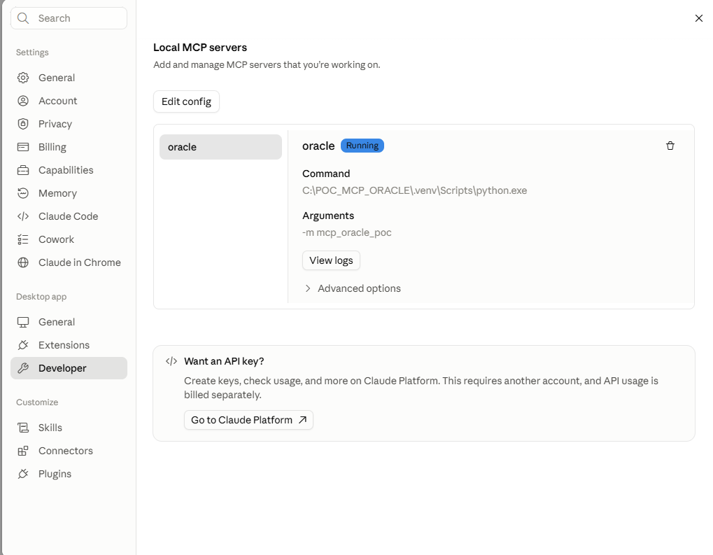
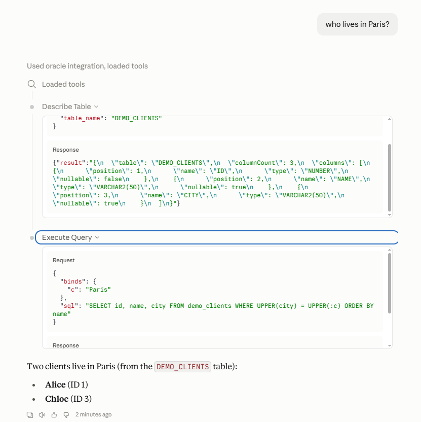
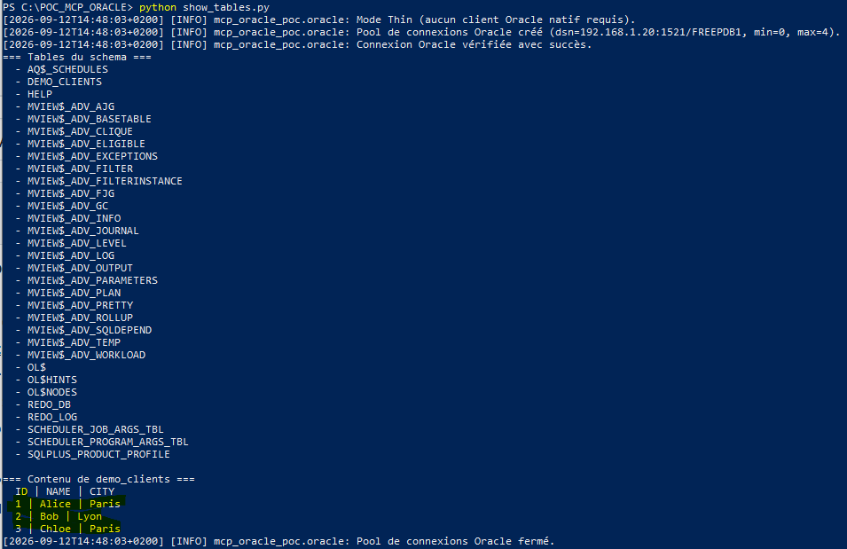

# MCP Oracle POC (Python)

A **MCP (Model Context Protocol)** server in **Python**, built with the
**[FastMCP](https://github.com/jlowin/fastmcp)** (v2) library, exposing tools for
Claude to interact with an **Oracle** database: list tables, describe a table,
run read-only `SELECT` queries, and perform `INSERT`/`UPDATE`/`DELETE` writes
with a two-step confirmation.

> Educational POC: built to be tested quickly, with reasonable safety
> guardrails. Harden it before any production use.

## Demo

The MCP server connected to **Claude Desktop**, answering natural-language
questions against a live **Oracle** database — end to end.

**1. The `oracle` server loaded in Claude Desktop** (Settings → Developer →
Local MCP servers):



**2. Querying the database in natural language** — Claude calls the
`execute_query` tool under the hood:


**3. "Who lives in Paris?"** — Claude turns the question into
`SELECT name FROM demo_clients WHERE city = :city` (using a *bind variable*, so
it is protected against SQL injection), runs it, and answers:



**4. The database seen directly in the terminal** — `python show_tables.py`
prints the tables and the `demo_clients` rows straight from Oracle (PowerShell):



---

## Table of contents

- [Demo](#demo)
- [Features](#features)
- [Architecture](#architecture)
- [Requirements](#requirements)
- [Installation](#installation)
- [Oracle configuration](#oracle-configuration)
- [Spinning up a test database](#spinning-up-a-test-database)
- [Running](#running)
- [Quick testing](#quick-testing)
- [Configuring Claude Desktop](#configuring-claude-desktop)
- [Configuring Claude Code](#configuring-claude-code)
- [Exposed tools](#exposed-tools)
- [Security](#security)
- [Troubleshooting](#troubleshooting)

---

## Features

- **4 MCP tools**: `list_tables`, `describe_table`, `execute_query`, `execute_dml`.
- **FastMCP (v2)**: tools declared with the `@mcp.tool()` decorator; input schema
  inferred from type hints + `pydantic.Field`.
- **Connection pool** via `python-oracledb` (borrow/return through a context manager).
- **Thin mode by default**: no native Oracle client required.
- **Safety guardrails**: strict read-only for queries, two-step confirmation for
  writes, DDL blocking, row-count cap, bind variables.
- **Clear logging** on `stderr` (never pollutes the MCP stdout channel).
- **Configuration via `.env`**, typed and validated at startup (fail-fast).

## Architecture

```
POC_MCP_ORACLE/
├── src/mcp_oracle_poc/
│   ├── __init__.py
│   ├── __main__.py            # `python -m mcp_oracle_poc`
│   ├── server.py             # Entry point: starts the MCP server (stdio)
│   ├── config.py             # Load + validate environment variables
│   ├── logging_config.py     # Logger (stderr only)
│   ├── oracle.py             # Connection pool + SQL safety helpers
│   └── tools/
│       ├── __init__.py       # Registers all tools
│       ├── common.py         # Helpers (row conversion, JSON, LOB)
│       ├── list_tables.py    # list_tables tool
│       ├── describe_table.py # describe_table tool
│       ├── execute_query.py  # execute_query tool (SELECT)
│       └── execute_dml.py    # execute_dml tool (INSERT/UPDATE/DELETE)
├── demo_setup.py             # Create a small demo table (demo_clients)
├── show_tables.py            # Print the tables + demo_clients in the terminal
├── test_connexion.py         # Quick Oracle connectivity test
├── test_mcp.py               # Test the tools via an in-memory MCP client
├── test_dml.py               # Dry-run / COMMIT demo of execute_dml
├── image/                    # Demo screenshots
├── pyproject.toml
├── requirements.txt
├── .env.example
└── README.md
```

## Requirements

- **Python ≥ 3.10**
- An accessible **Oracle** database (installed locally, via Docker, or remote).
- `python-oracledb` runs in **Thin mode** with no Instant Client. Thick mode is
  only needed for advanced features.

## Installation

```bash
# 1. (Recommended) Create a virtual environment
python -m venv .venv
source .venv/bin/activate          # Windows: .venv\Scripts\activate

# 2. Install the project into THIS environment
pip install -e .

# 3. Create your configuration file
cp .env.example .env               # Windows: copy .env.example .env
# then edit .env with your Oracle credentials
```

> **Important:** install the project into the **same** Python interpreter the MCP
> client will launch. If you create a virtualenv, run `pip install -e .` inside
> it (e.g. on Windows: `.venv\Scripts\python.exe -m pip install -e .`). Otherwise
> you will get `No module named mcp_oracle_poc`.

## Oracle configuration

Set these variables in `.env` (see `.env.example`):

| Variable                   | Required | Description                                                    |
| -------------------------- | :------: | -------------------------------------------------------------- |
| `ORACLE_USER`              |   yes    | Oracle user.                                                   |
| `ORACLE_PASSWORD`          |   yes    | Password.                                                      |
| `ORACLE_CONNECTION_STRING` |   yes    | Easy Connect `host:port/service` or a tnsnames alias.          |
| `ORACLE_POOL_MIN`          |    no    | Minimum pool connections (default `0`).                        |
| `ORACLE_POOL_MAX`          |    no    | Maximum pool connections (default `4`).                        |
| `QUERY_MAX_ROWS`           |    no    | Row cap for `execute_query` (default `100`).                   |
| `ALLOW_DML`                |    no    | `false` for a strictly read-only server (default `true`).      |
| `ORACLE_CLIENT_LIB_DIR`    |    no    | Instant Client path to enable Thick mode.                      |
| `LOG_LEVEL`                |    no    | `DEBUG` \| `INFO` \| `WARNING` \| `ERROR` (default `INFO`).     |

**Example `ORACLE_CONNECTION_STRING`** (Easy Connect): `localhost:1521/FREEPDB1`

## Spinning up a test database

Two easy options for a local database:

**Native installer (Windows/Linux)** — download **Oracle Database Free** from
<https://www.oracle.com/database/free/>. The installer automatically creates a
ready-to-use database (service `FREEPDB1`); use the password you set during
installation.

**Docker** — community image, no Oracle account required:

```bash
docker run -d --name oracle-free -p 1521:1521 -e ORACLE_PASSWORD=change_me gvenzl/oracle-free
```

Then in `.env`:

```
ORACLE_USER=system
ORACLE_PASSWORD=change_me
ORACLE_CONNECTION_STRING=localhost:1521/FREEPDB1
```

## Running

```bash
python -m mcp_oracle_poc
# or, if installed as a package:
mcp-oracle-poc
```

The server logs to **stderr** and speaks MCP over **stdout**; it is normal for it
to "just wait" — it is driven by an MCP client.

## Quick testing

Several helper scripts are provided (virtualenv active, `.env` filled in):

```bash
python demo_setup.py       # create a demo table demo_clients (3 rows)
python show_tables.py      # print the tables + the content of demo_clients
python test_connexion.py   # check the Oracle connection
python test_mcp.py         # call the tools via an in-memory MCP client
python test_dml.py         # show the dry-run simulation then the real COMMIT
```

You can also launch the **MCP Inspector** via FastMCP (requires Node.js):

```bash
fastmcp dev src/mcp_oracle_poc/server.py
```

## Configuring Claude Desktop

Open **Settings → Developer → Edit config** and add the `oracle` server (use
**absolute paths**, and the Python from your virtualenv):

```json
{
  "mcpServers": {
    "oracle": {
      "command": "C:\\POC_MCP_ORACLE\\.venv\\Scripts\\python.exe",
      "args": ["-m", "mcp_oracle_poc"],
      "env": {
        "ORACLE_USER": "system",
        "ORACLE_PASSWORD": "change_me",
        "ORACLE_CONNECTION_STRING": "localhost:1521/FREEPDB1",
        "QUERY_MAX_ROWS": "100",
        "ALLOW_DML": "true"
      }
    }
  }
}
```

On Windows, paths use **double backslashes** `\\`. Fully quit and reopen Claude
Desktop: the `oracle` server appears under **Settings → Developer → Local MCP
servers**. Then ask: *"List the tables in my Oracle database."*

> **Local** (stdio) MCP servers are configured through this config file — **not**
> through "Add custom connector", which is for remote HTTPS servers.

## Configuring Claude Code

```bash
claude mcp add oracle -- python -m mcp_oracle_poc
```

Or via `.mcp.json` at the project root:

```json
{
  "mcpServers": {
    "oracle": {
      "command": "python",
      "args": ["-m", "mcp_oracle_poc"]
    }
  }
}
```

## Exposed tools

### `list_tables`

List the tables of the current schema, or of a given schema.

```jsonc
{ "owner": "HR" }   // optional; defaults to the current user
```

### `describe_table`

Describe a table's columns (name, type, nullability).

```jsonc
{ "table_name": "EMPLOYEES", "owner": "HR" }  // owner optional
```

### `execute_query`

Run a **read-only** `SELECT` (or `WITH ... SELECT`), with bind variables and a
row cap.

```jsonc
{
  "sql": "SELECT * FROM employees WHERE department_id = :dep",
  "binds": { "dep": 10 },
  "max_rows": 50
}
```

### `execute_dml`

Run `INSERT` / `UPDATE` / `DELETE` with a **two-step confirmation**:

- `confirm` absent or `false` → **simulation** (dry-run): reports how many rows
  would be affected, then `ROLLBACK` (nothing is modified).
- `confirm: true` → real execution with `COMMIT`.

```jsonc
// 1) simulate
{ "sql": "UPDATE employees SET salary = salary * 1.1 WHERE department_id = :d", "binds": { "d": 10 } }

// 2) execute for real (after user validation)
{ "sql": "UPDATE employees SET salary = salary * 1.1 WHERE department_id = :d", "binds": { "d": 10 }, "confirm": true }
```

## Security

This POC applies several guardrails:

- **Read/write separation**: `execute_query` rejects anything that is not
  `SELECT`/`WITH`; `execute_dml` only accepts `INSERT`/`UPDATE`/`DELETE`.
- **DDL and PL/SQL blocking**: `DROP`, `TRUNCATE`, `ALTER`, `CREATE`, `GRANT`,
  `MERGE`, `BEGIN`, `EXECUTE`, etc. are blocked everywhere.
- **Anti "stacked queries"**: a single statement per call.
- **Write confirmation**: dry-run + `ROLLBACK` by default, `COMMIT` only on
  `confirm: true`.
- **Missing-`WHERE` warning** on `UPDATE`/`DELETE`.
- **Row cap** (`QUERY_MAX_ROWS`) to avoid dumps.
- **Bind variables** to prevent SQL injection.
- **Kill switch**: `ALLOW_DML=false` makes the server strictly read-only.

**Going further:** create a dedicated Oracle user with least privileges (ideally
read-only) instead of `system`, enable Oracle auditing, and restrict the network.
Application-level guardrails do not replace properly configured database
privileges.

## Troubleshooting

- **`ORA-01017` (invalid credentials)**: check `ORACLE_USER` / `ORACLE_PASSWORD`.
- **`ORA-12514` (unknown service)**: check the service in
  `ORACLE_CONNECTION_STRING` (e.g. `FREEPDB1`).
- **`DPY-6005` / connection refused (`WinError 10061`)**: nothing is listening on
  the given host/port. Check the listener address
  (`netstat -ano | findstr 1521`): if it only listens on the machine's LAN IP
  (e.g. `192.168.1.20`), use **that IP** in `ORACLE_CONNECTION_STRING` instead of
  `localhost`.
- **`No module named mcp_oracle_poc`**: the package is not installed in the Python
  being launched — run `pip install -e .` in **that** same environment (venv).
- **Claude Desktop shows "Server disconnected"**: usually a crash at startup (see
  the points above) or stdout pollution — this project starts FastMCP with
  `show_banner=False` to keep the stdio channel clean.
- **The server "does nothing"**: that is expected — it waits for an MCP client.

---

## License

MIT — provided as an example POC.
